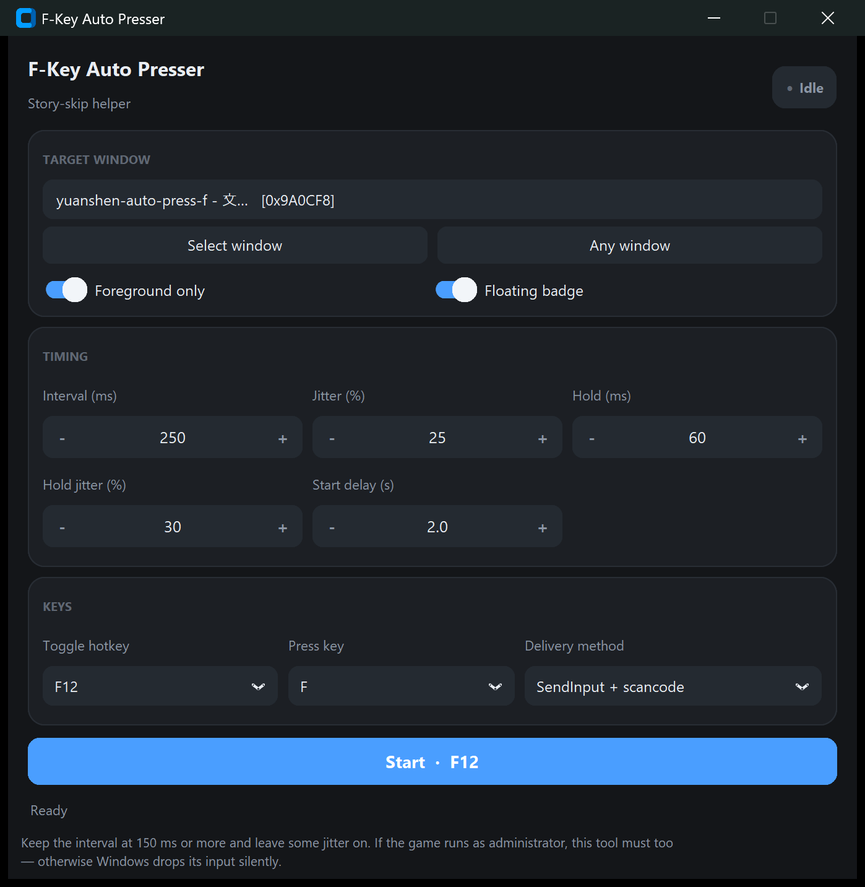

# F-Key Auto Presser

A tiny **Windows-only** helper that repeatedly presses a key for you — built to
auto-skip dialogue and cutscenes in *Genshin Impact* (原神).



It sends real keyboard input through Win32 (`SendInput` / `keybd_event` / `PostMessage`),
so the game reacts to it exactly as it would to you pressing the key. Everything runs
locally: no network access, no telemetry, no external services.

> ⚠️ **Windows only.** Relies on `user32`, so it does nothing on macOS or Linux.

## Features

- **Interval + hold jitter** — press timing is randomised so it doesn't look robotic.
- **Window binding** — optionally send input only while a specific window is in the
  foreground (auto-binds the game window when it can find it).
- **Five delivery methods** — from real `SendInput` to `PostMessage`, for games that
  ignore injected input.
- **Floating status badge** — an always-on-top dot that never steals focus from the game;
  click to start/stop, drag to move, right-click for a menu.
- **Hotkey toggle** — F6–F12, configurable in the UI.
- **Remembers everything** — settings, badge position and target window persist to JSON.
- **No console window** — the app is packaged as a GUI (`pythonw`) entry point.

## Requirements

- Windows 10/11
- [uv](https://docs.astral.sh/uv/) — it fetches a suitable Python and the one dependency
  (`customtkinter`) for you, no manual `pip install`
- `git` — only needed when installing straight from GitHub (see below)
- Administrator rights **if** the game itself runs as administrator (otherwise Windows
  silently drops the injected input)

## Install & run

Nothing to clone: `uv` fetches the repository, builds it in a cache and runs the app.

```bash
uvx --from git+https://github.com/go66/yuanshen-auto-press-f auto-press-f
```

Click **Yes** on the UAC prompt. The build is cached, so later launches are instant.

Want a permanent launcher instead of a command? Install it as a uv tool and start it by
name afterwards:

```bash
uv tool install git+https://github.com/go66/yuanshen-auto-press-f
auto-press-f
```

### From a local checkout

```bash
uvx --from . auto-press-f   # builds and runs the code in this folder
uv run main.py              # always the current source (best while editing)
python main.py              # plain Python, if you already have the deps installed
```

### Command-line flags

| Flag           | Effect                                                        |
| -------------- | ------------------------------------------------------------- |
| `--no-elevate` | Skip the UAC round trip (e.g. when launched from an admin shell) |

## Usage

1. The app auto-binds the Genshin window on start. If it doesn't, click
   **Select window** to pick one, or **Any window** to send everywhere.
2. Press the hotkey (default **F12**) to start/stop, or use the big button.
3. Tune interval, jitter, hold time and start delay — changes save immediately.

### Floating status badge

A small always-on-top circle so you can see the state without Alt-Tabbing to the window:

| Look                   | Meaning                      |
| ---------------------- | ---------------------------- |
| Green ring + green `F` | Auto-pressing is **running** |
| Gray ring + gray `F`   | Auto-pressing is **stopped** |

- **Drag** it anywhere — the position is remembered next launch.
- **Left-click** to start/stop (same as the hotkey).
- **Right-click** for a menu: start/stop, show the main window, hide the badge.
- **Hover** for the exact status text (e.g. how many presses were sent).

The badge never takes focus from the game and stays out of Alt-Tab. If the game runs in
**exclusive fullscreen** the badge won't be visible — use windowed / borderless instead.

### Recommended settings

- Keep the press interval **≥ 150 ms** and leave some jitter on. It behaves more like a
  human and avoids being flagged.
- If the game runs as administrator, this tool **must** run as administrator too.

## Delivery methods

| Method       | What it does                                | When to use                                  |
| ------------ | ------------------------------------------- | -------------------------------------------- |
| `scan`       | `SendInput` with a scan code                | Default; works with most games                |
| `vk`         | `SendInput` with a virtual key              | If scan codes are ignored                     |
| `keybd`      | `keybd_event` with a scan code              | Legacy fallback                               |
| `post`       | `PostMessage` to the window                 | When the game is not focused                  |
| `post_child` | `PostMessage` to the window and its children | When `post` has no effect on the input widget |

## Configuration

Settings live in `config.json`, saved automatically on every change. Where
that file is:

| Launched as                                              | Location                                 |
| -------------------------------------------------------- | ---------------------------------------- |
| `uvx --from git+https://…` (or `uv tool install`)         | `%LOCALAPPDATA%\AutoPressF\`             |
| `uvx --from .` / `uv run main.py` / `python main.py`      | Next to the sources                      |
| any of the above, started inside a folder that already has the file | that folder                    |

Set the `AUTO_PRESS_F_CONFIG` environment variable to a full file path to force a
specific config file.

| Field             | Meaning                                | Default |
| ----------------- | -------------------------------------- | ------- |
| `interval_ms`     | Delay between presses (ms)             | 250     |
| `jitter_pct`      | Random interval variation (%)          | 25      |
| `hold_ms`         | How long the key is held down (ms)     | 60      |
| `hold_jitter_pct` | Random hold variation (%)              | 30      |
| `start_delay_s`   | Countdown before pressing starts (s)   | 2.0     |
| `only_foreground` | Only send while the target is in front | true    |
| `hotkey`          | Start/stop hotkey (F6–F12)             | F12     |
| `press_key`       | Key to auto-press                      | F       |
| `method`          | Delivery method (see above)            | scan    |
| `target_hwnd`     | Bound window handle (`0` = any window) | 0       |
| `overlay_visible` | Show the floating badge                | true    |
| `overlay_x` / `overlay_y` | Badge position (`-1` = default top-right) | -1 |

`press_key` accepts F1–F12, A–Z, 0–9 and `Space` / `Enter` / `Tab` / `Esc`. The dropdown
only lists function keys and special keys to keep the menu short; edit the JSON for
letters and digits.

## Troubleshooting

Every launch appends a few breadcrumbs to **`auto_press_f.log`** (next to the config
file), and a full traceback if startup fails. The app runs windowless, so that file —
not a console — is the place to look. A denied UAC prompt is recorded there too.

| Symptom                                  | Likely cause                                                                 |
| ---------------------------------------- | ---------------------------------------------------------------------------- |
| Nothing is pressed                       | Game runs elevated, tool doesn't (or vice versa). Run both as administrator.  |
| `Delivery method` change doesn't help    | Try `post` / `post_child`, or run the tool as administrator.                  |
| Pressing stops when you click the window  | `only_foreground` is on — that's intended. Turn it off or focus the game.     |
| Changes don't take effect                 | `uvx` caches builds: push a new commit (git install) or bump `version` in `pyproject.toml` (local install). `uv run main.py` always uses the current source. |
| Badge not visible                        | Game is in exclusive fullscreen, or hide it and re-enable via the checkbox.   |

## Project layout

| File / folder        | Purpose                                                        |
| -------------------- | -------------------------------------------------------------- |
| `main.py`            | UI (customtkinter), wiring, floating badge, window picker       |
| `auto_press_f.py`    | Win32 key injection, window enumeration, config persistence     |
| `elevate.py`         | UAC re-launch logic (works for both source and `uvx` installs)  |
| `pyproject.toml`     | uv project metadata, `auto-press-f` GUI entry point             |
| `docs/screenshot.png`| The screenshot above                                            |

## Disclaimer

Use at your own risk. Auto-play tools may violate a game's terms of service; this project
is provided for personal, educational use only.
